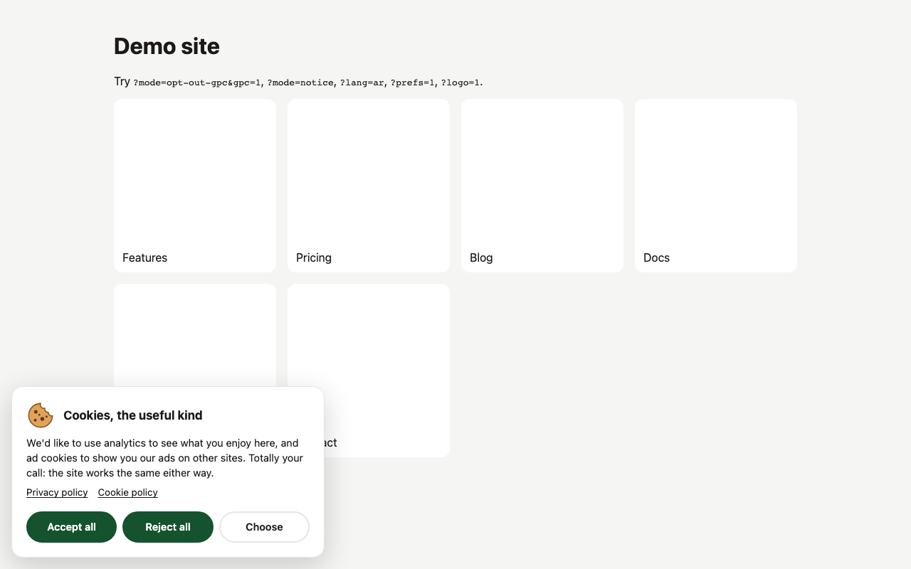
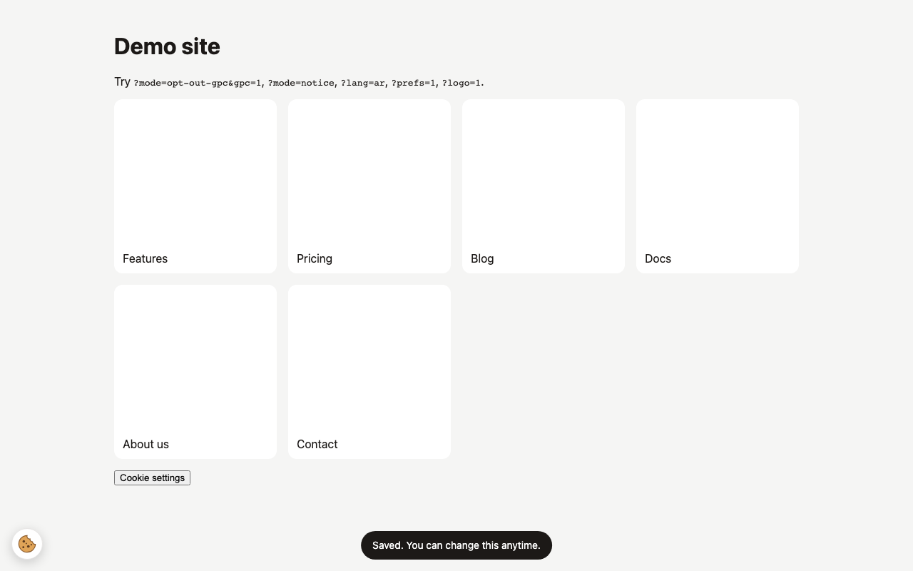
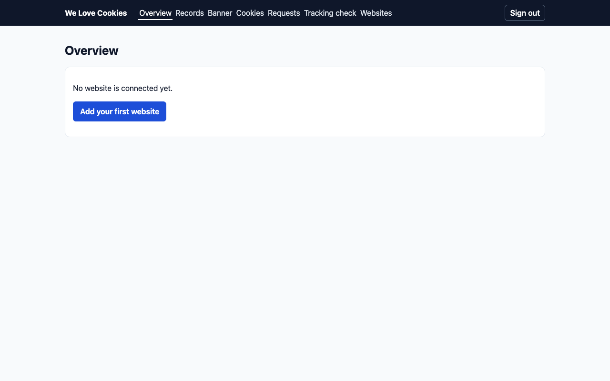

# Testing

How We Love Cookies is tested, and how to run each layer yourself. There is no CI: run these before merging and before a release.

Needs Node 22.13 or newer (for the built-in `node:sqlite`). `npm run build` and `npm run test:local` also need the `zip` command.

## The layers

| Layer | Command | What it proves | Time |
| --- | --- | --- | --- |
| Unit and contract | `npm test` | Consent manager, region rules, cookie format (pinned so saved choices keep working), signals, auto-clear, translations, banner UI in happy-dom, script-tag config, the admin on its real database migration (`node:sqlite`), and that the committed `dist/` scripts match a fresh build | ~15 s |
| Docs drift | `npm test` (`src/docs.test.ts`) | Wiki citations, `[[wiki links]]` and relative Markdown links still point at things that exist; the API spec's enums match the code | included |
| Versions | `npm test` (`src/version.test.ts`) | `package.json`, `package-lock.json`, both version fields in `welovecookies.php`, `readme.txt` `Stable tag` and the newest `CHANGELOG.md` release all agree | included |
| Types, lint, format | `npm run check`, `npm run lint`, `npm run format:check` | TypeScript for the root, admin, tools, browser tests and Svelte wrapper; ESLint; Prettier | ~1 min |
| Real browser | `npm run test:e2e` | The banner and the admin in Chromium: Accept all and Reject all save the right `wlc_consent` cookie, the choice survives a reload, the opt-out notice and notice mode show what they should, Arabic reads right to left, admin sign-in refuses a wrong password and opens the admin with the right one, and the public endpoints answer | ~1 min |
| Fresh install | `npm run test:local` | A clean copy of your current files (committed or not) installs with `npm ci` and passes every check, the build leaves the committed scripts unchanged, and the demo and admin work over HTTP | ~4 min |

`npm test` stays fast and needs no browser; the browser and fresh-install tests are separate commands.

## Real-browser test (Playwright)

One-time setup after `npm install` (downloads Chromium, about 150 MB):

```sh
npx playwright install chromium
```

Then:

```sh
npm run test:e2e
```

It starts two servers itself:

- the demo on http://127.0.0.1:4174/demo/ (not the usual 4173, so a demo you already have running is never tested by mistake);
- a test admin on http://127.0.0.1:8788 (`e2e/start-admin.mjs`), beside any `npm run admin:dev` on 8787. It uses a fresh throwaway database in your system's temp folder and a test-only password from `e2e/admin-env.mjs`, so your own local admin data and `admin/.dev.vars` are never used or changed.

Ports 4174 and 8788 must be free, so run one of `test:e2e`, `screenshots` and `test:local` at a time. The specs are in `e2e/`. On failure, a trace is kept in `test-results/` (`npx playwright show-trace <path>`).

## Fresh-install test

```sh
npm run test:local
```

Copies the files git tracks or would track (not ignored files such as `node_modules`, `admin/.dev.vars` or local data) into a temp folder, then runs, stopping at the first failure:

1. `npm ci`
2. `npm test`, `npm run check`, `npm run lint`, `npm run format:check`
3. `npm run build`, and checks `dist/welovecookies.min.js` and `dist/welovecookies.mjs` did not change
4. the demo (on port 4183): the page and the script load, with the licence banner
5. the test admin: sign in over HTTP, open Overview, and an unknown website gets 404

It prints `PASS` or `FAIL` per step and always stops its servers and deletes the temp folder (on Windows, check nothing is left on port 8788 after stopping it early with Ctrl-C). It needs network access (or a warm npm cache) for `npm ci`.

## Screenshots

`npm run screenshots` runs the browser tests and saves these pictures (1280×800) to `docs/assets/screenshots/`. Re-run it after changing the banner or admin look, and commit the PNGs.

The ask-first banner a visitor sees on first visit:



After Accept all: the "Saved" message and the cookie button for changing the choice later:



The optional admin after signing in, on a fresh database:


