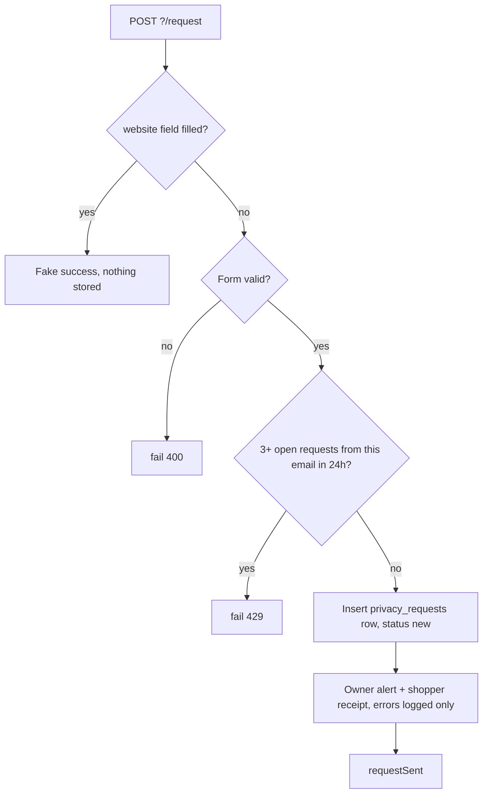
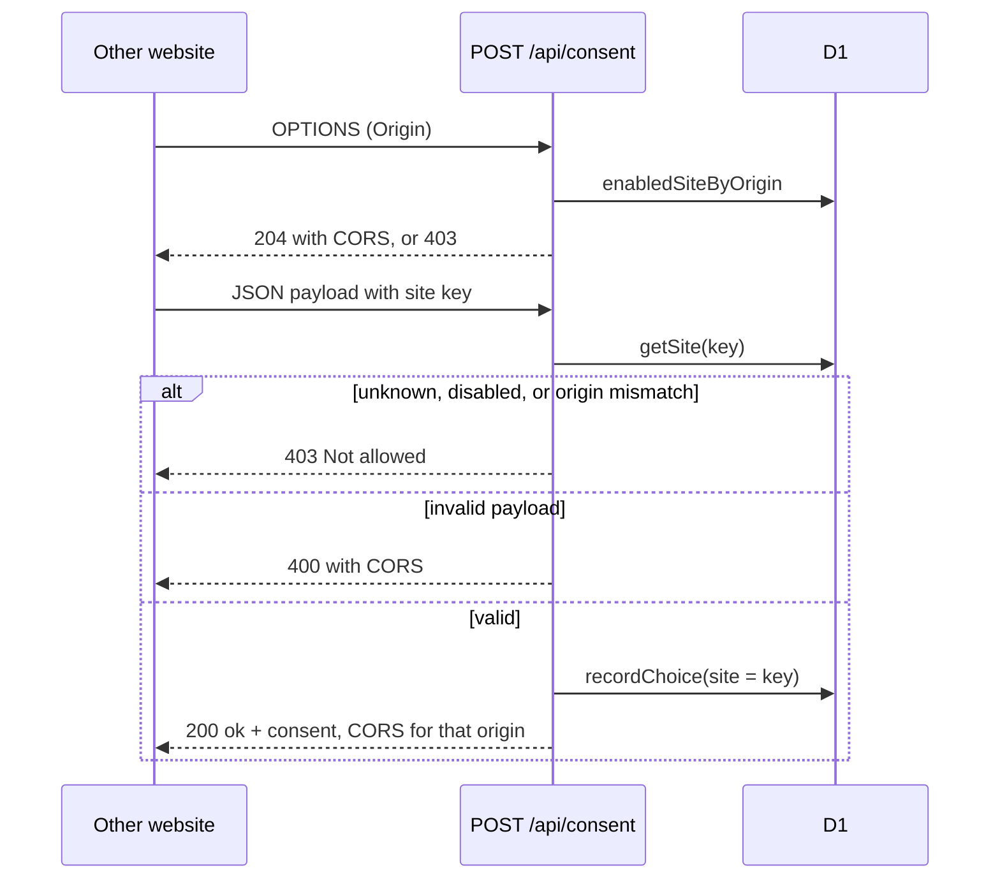

# Privacy Requests and Consent Sites

> Category: Privacy | Version: 1.0 | Date: November 2026 | Status: Active

For engineers changing We Love Cookies' shopper privacy requests or its hosted install on other websites (consent sites): the tables, the request lifecycle, the cross-origin rules and the owner screens. Engineering defaults, not legal advice. File citations are relative to `reference/server/`.

**Related:**
- [`how-it-works.md`](how-it-works.md)
- [`consent-law-matrix.md`](consent-law-matrix.md)
- [`consent-ux-research.md`](consent-ux-research.md)
- [`README.md`](README.md)

---

## Why these two features exist

Shoppers need one place to ask the store to delete, copy, correct, or stop selling or sharing their data, and the owner needs a queue with a deadline for each ask (`src/lib/server/privacy/requests.ts:1-3`). The code records and tracks the request; it never changes customer data by itself and never stores an IP address (`src/lib/server/privacy/requests.ts:2`).

Consent sites let the owner run the same cookie banner on other websites they own. Each site gets a site key and may load its config and send records only from its own exact origin (`src/lib/server/consent/sites.ts:1-5`).

---

## Tables (migration 0037)

Migration `0037` adds three tables and tags every consent record with the site it came from (`migrations/0037_consent_sites_privacy_requests.sql:1-42`). An empty `site` means the store itself (`src/lib/server/consent/sites.ts:162-164`).

```sql
CREATE TABLE `consent_site_daily` (
	`day` text NOT NULL,
	`site` text NOT NULL,
	`metric` text NOT NULL,
	`mode` text NOT NULL,
	`country` text DEFAULT '' NOT NULL,
	`device` text DEFAULT '' NOT NULL,
	`count` integer DEFAULT 0 NOT NULL,
	PRIMARY KEY(`day`, `site`, `metric`, `mode`, `country`, `device`)
);
CREATE TABLE `consent_sites` (
	`id` text PRIMARY KEY NOT NULL,
	`name` text NOT NULL,
	`origin` text NOT NULL,
	`privacy_url` text DEFAULT '' NOT NULL,
	`cookies_json` text,
	`enabled` integer DEFAULT 1 NOT NULL,
	`created_at` integer NOT NULL
);
CREATE TABLE `privacy_requests` (
	`id` text PRIMARY KEY NOT NULL,
	`created_at` integer NOT NULL,
	`kind` text NOT NULL,
	`status` text DEFAULT 'new' NOT NULL,
	`email` text NOT NULL,
	`name` text DEFAULT '' NOT NULL,
	`message` text DEFAULT '' NOT NULL,
	`consent_id` text,
	`customer_id` text,
	`country` text,
	`region_code` text,
	`due_at` integer NOT NULL,
	`closed_at` integer,
	`note` text DEFAULT '' NOT NULL,
	`site` text DEFAULT '' NOT NULL
);
CREATE INDEX `privacy_requests_created_idx` ON `privacy_requests` (`created_at`);
CREATE INDEX `privacy_requests_status_idx` ON `privacy_requests` (`status`);
ALTER TABLE `consent_records` ADD `site` text DEFAULT '' NOT NULL;
```

`consent_records` itself comes from migration `0034`; see [`how-it-works.md`](how-it-works.md). Which code writes `consent_site_daily` is not traced here (unverified).

---

## Privacy request lifecycle

The shopper fills the form on Your privacy choices (`/privacy-choices`). The `request` action runs these steps in order (`src/routes/(store)/privacy-choices/+page.server.ts:50-83`):

1. A filled hidden `website` field (honeypot) returns a fake success and stores nothing (`+page.server.ts:62-63`).
2. A signed-in shopper's account email replaces whatever email they typed (`+page.server.ts:61,64`).
3. The zod schema checks kind, email (lowercased, max 254), name (max 120) and message (max 1,000); a failure returns 400 (`src/lib/server/privacy/requests.ts:32-45`, `+page.server.ts:65-69`).
4. `createPrivacyRequest` refuses a fourth open request from the same email within 24 hours with 429 (`requests.ts:21-22,61-77`, `+page.server.ts:77`).
5. The row is inserted with status `new`, the consent id (when a current, non-legacy choice exists), customer id (signed-in only), country and region (`requests.ts:78-95`, `+page.server.ts:70-76`).
6. `notifyPrivacyRequest` emails the owner (only when `store.email` is set) and sends the shopper a receipt. Each email has its own try/catch and an idempotency key, so a failed email never loses the saved request (`requests.ts:104-143`).

The deadline comes from the shopper's country: Brazil 15 days, US 45, everyone else 30 (`requests.ts:24-30`). The page shows the same number before the shopper submits (`+page.server.ts:45`).



### Owner side

`/admin/privacy/requests` requires an admin session (401 otherwise) and sends `private, no-store` (`src/routes/admin/privacy/requests/+page.server.ts:13-15`). The `show` filter is `open` (statuses `new` and `in_progress`, soonest due first), `done` (`done` and `declined`) or `all` (`src/lib/server/privacy/requests.ts:155-169`). The `save` action passes `rejectAdminWrite` first, maps the form value `working` to `in_progress`, and calls `updateRequest` (`requests/+page.server.ts:29-41`). Closing a request stamps `closed_at` once; reopening clears it; notes are cut at 2,000 characters (`requests.ts:174-190`).

The request page `/admin/privacy/requests/[id]` shows "What we hold about them" from `dataSummary`, a read-only query (`src/lib/server/privacy/summary.ts:1`). It matches the customer by linked id, else by email, then gathers orders, order items, reviews by author email, all requests from that email, and consent records by consent id or customer id, plus deduplicated addresses (`summary.ts:14-94`). The customer id is stripped before the page sees it (`requests/[id]/+page.server.ts:10-14`); the `account` endpoint redirects to the customer page instead, so the id never appears in the list (`requests/[id]/account/+server.ts:1-15`).

---

## Consent sites (hosted install)

### Adding a site

`/admin/privacy/sites` requires an admin session and `private, no-store` (`src/routes/admin/privacy/sites/+page.server.ts:17-19`). Every action passes `rejectAdminWrite` first (`sites/+page.server.ts:46,79,96`).

`normaliseWebsite` turns `example.com` or `https://example.com/` into `https://example.com` and rejects credentials, query, fragment, any path and single-label hosts. It always returns `https://`, even for an `http://` input (`src/lib/server/consent/sites.ts:25-41`). The optional privacy link must start with `https://` (`sites.ts:46-57`). Adding refuses the store's own origin and an origin already in the list (`sites/+page.server.ts:57-64`). The site key is `ws_` plus 12 random URL-safe characters (`sites.ts:14-23`). The page shows the snippet to paste:

```html
<script src="{store origin}/consent/welovecookies.min.js" data-site="{site key}" async></script>
```

(`sites/+page.server.ts:31`). Turning a site off or removing it keeps its past records; records of a removed site show as "Removed website" (`sites/+page.server.ts:78-104`, `sites.ts:161-165`). The list counts each site's records over the last 30 days (`sites.ts:135-150`). A site may carry its own cookie list in `cookies_json`; an invalid or empty one falls back to the store's list (`sites.ts:124-133`).

### Cross-origin record flow

`POST /api/consent` treats any request whose `Origin` differs from the store as another website (`src/routes/api/consent/+server.ts:57-85`). Form posts from another origin get 403 before parsing (`+server.ts:61`). For JSON, `siteForRequest` looks up the `site` key; an unknown or disabled site, or an origin that is not the site's exact origin, ends in 403 (`sites.ts:89-98`, `+server.ts:68-69`). The record is then saved with `site` set to the site key and the page reduced to a path on that site's origin (`+server.ts:75-83`). Responses carry `access-control-allow-origin` for that one origin and never allow credentials (`sites.ts:111-115`). The cookie written by the server (`setCookie`) is only requested on the store's own legacy choice path (`+server.ts:107-108`), not for other sites.

Preflight `OPTIONS` answers 204 only when some enabled site has the exact origin, else 403 (`+server.ts:132-136`, `sites.ts:100-109`).



The config and seen endpoints (`src/routes/api/consent/config/+server.ts`, `src/routes/api/consent/seen/+server.ts`) also serve other sites; their checks are not traced in this doc (unverified).

---

## Known limitations

- Request kinds and status values live in `PRIVACY_REQUEST_KINDS` and `PRIVACY_REQUEST_STATUSES` in `src/lib/consent/types.ts`; this doc lists only the ones the cited code names (unverified for the full set).
- The `site` column on `privacy_requests` exists, but `createPrivacyRequest` does not set it, so it stays empty (`requests.ts:81-94`).
- Nothing deletes or exports customer data automatically; the owner acts by hand from the summary (`requests.ts:2`, `summary.ts:1`).
